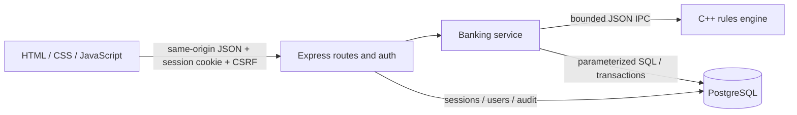

# Architecture and database

`public/` owns presentation and client validation. `server/app.js` owns routing/HTTP, `auth.js` session authentication and RBAC, `banking.js` business orchestration, `core.js` bounded child-process IPC, `validation.js` input policies, `crypto.js` password hashing and token creation, `db.js` pool/transaction/migration boundaries. `core/banking.hpp` contains pure integer banking rules; `main.cpp` implements the IPC contract. This follows SAD's layered design; see the audit for differences from older SRS deployment details.

## Data model

| Table | Purpose / constraints |
|---|---|
| users | UUID primary key, unique login, salted scrypt hash, CUSTOMER/ADMIN role, failed attempt count 0–3 and persistent lock flag |
| accounts | UUID, unique generated number, unique user foreign key, name/phone/address, SAVINGS type, bounded BIGINT balance, ACTIVE/CLOSED status, timestamps; CLOSED implies zero balance |
| transactions | UUID, account foreign key, positive BIGINT amount, bounded resulting balance, four ledger types, timestamp, unique `(account_id,request_key)` |
| sessions | SHA-256 of random 256-bit bearer token as primary key, user foreign key, independently random CSRF token and absolute expiry |
| audit_events | UUID, event name, optional actor/account foreign keys, timestamp |
| schema_migrations | applied version and timestamp |

Indexes support account number and user lookups, lowercase names, recent account transactions, session-user invalidation and expiry. Substring searches with ILIKE may scan the small account table; no unsupported claim of indexed arbitrary substring lookup. Users and customers are represented by a one-to-one user/account relation rather than a redundant customer table. Administrators have a user without a bank account. No hard-delete route exists; foreign keys and retained ledger preserve history.

## Transaction boundaries

Deposits/withdrawals begin a PostgreSQL transaction, select the account `FOR UPDATE`, verify ownership/status, check the unique retry key, invoke C++ against the locked balance, update the balance and insert the ledger row, then commit. Only after commit does the API report approval. Under PostgreSQL's default READ COMMITTED isolation, a competing request waits on the account lock and sees the committed balance. Retries return the existing ledger row. Failure at any intermediate step rolls back both writes.

Creation atomically inserts user, account, OPENING ledger and audit event. Initial deposit is approved by C++ before any DB writes. Closure locks the account, evaluates full settlement in C++, writes SETTLEMENT for nonzero funds, zeros and closes the account, removes sessions and audits, all in one transaction. Login locks the user row to serialize failure counters and adds/removes sessions in the same transaction. Contact updates lock and audit the account.

## Setup and migrations

Create a dedicated PostgreSQL database owned by an application role. Run `npm run migrate` with DATABASE_URL set. Migration 001 creates the schema inside one transaction; the runner uses a PostgreSQL advisory transaction lock, records its version, and safely does nothing on subsequent runs. A failed migration rolls back, including the version entry. Future migrations must be additional numbered SQL files plus explicit runner version steps; do not edit applied migrations on a shared database.

The application refuses startup if the database URL or migrated schema is absent. It never silently creates a different persistence backend. The server and frontend run as one process; the C++ executable is spawned per operation. Data survives application restarts in PostgreSQL. Use PostgreSQL backup/restore tooling and a restricted DB role for shared hosting. Do not commit database directories, dumps, passwords or real customer data.

## Development data and reset

No shared/default administrator is created by migrations. `npm run admin` creates one using developer-supplied environment values, then those provisioning values should be removed. Admins create fictional customers through the UI. Test credentials exist only in disposable test fixtures; no production seed user exists.

**Destructive reset warning:** Never reset a shared or real-data database to fix an error. For a disposable development environment, stop the app, back up anything needed, and choose a new, empty development database instead of dropping the old one. Point DATABASE_URL to the new database and rerun migrate/admin. Test helpers create uniquely named schemas only within a database named `bank_test_*` and clean up only those generated schemas. The portable PostgreSQL test runner leaves generated clusters in ignored `build/postgres-test-*` for diagnosis; they are not application data.

## Hosting

Public hosting requires HTTPS termination at a reverse proxy and `NODE_ENV=production`, a matching `https://` APP_ORIGIN and secure cookies. The application binds loopback by default. Do not enable broad CORS or accept forwarded IP headers from untrusted proxies. Rate limiting uses the actual socket IP; behind a reverse proxy it intentionally applies to that proxy address until a deliberate trusted-proxy policy is configured. PostgreSQL TLS/CA validation is configured through the connection string/platform; do not disable certificate verification. No public host, TLS certificate, deployment or operational backup is provisioned by this change.
