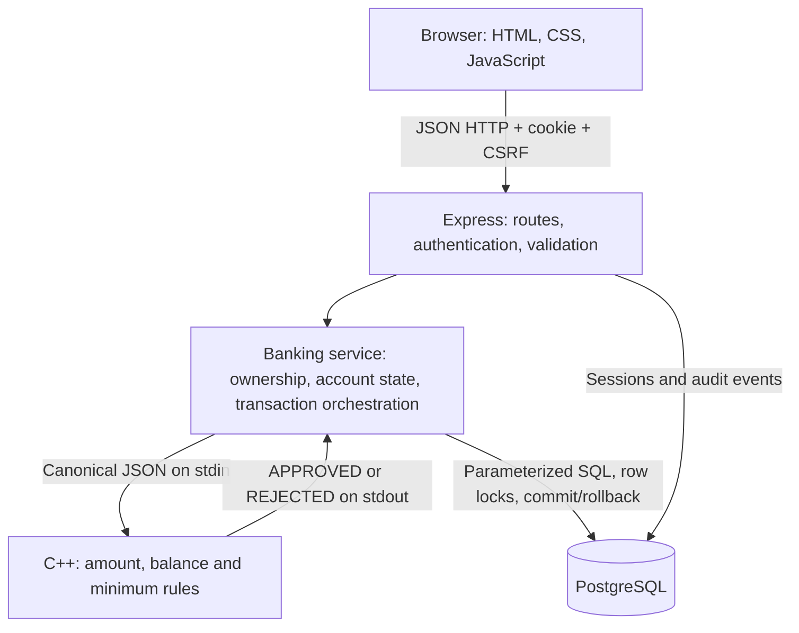

# Complete system handoff — what every part does

Read the [evaluation guide](sprint1-evaluation.md) for exact sprint scope and [individual preparation sheets](member-preparation.md) for who should explain each area. This guide describes the checked-in implementation; ownership is based on the backlog and does not assert who independently wrote each line.

## 1. The application in one paragraph

Bank Six is a student banking ledger application. A customer signs in using an automatically generated account number and a password, sees their own balance, deposits or withdraws fictional funds, views transactions and updates contact details. An administrator opens accounts, searches/view accounts, unlocks customer access and closes accounts with a recorded settlement. The browser calls an Express API. Express authenticates and validates the request, reads/locks PostgreSQL data and invokes a C++ executable for financial rule decisions. Only a committed SQL transaction produces a successful banking response. There are no real payment gateways, loans, interest, fees, transfers or real payouts.

## 2. Understand the four layers



**Frontend** means the pages/buttons/forms the user sees. **Backend** means the server receiving requests and deciding what that user may do. **Core engine** means the course-mandated C++ code deciding money rules. **Database** means durable relational storage. C++ does not display pages or directly write this project's database; the SAD assigns those responsibilities to Express.

Why both JavaScript and C++? JavaScript handles web requests and integration; C++ remains central to rule-sensitive banking. Why PostgreSQL? The SRS explicitly requires it, and it provides transactions, row locks, constraints and persistent storage.

## 3. Repository map — every authored module/configuration

| File or folder | What it does | Who should lead the explanation |
|---|---|---|
| `public/index.html` | HTML entry page, responsive viewport, linked CSS/module script, app root, status notice and native transaction dialog | Ganavi |
| `public/style.css` | Green banking theme, sidebar/header/cards/tables/forms, dialog and error states, keyboard focus and mobile layouts | Ganavi |
| `public/app.js` | Client state, safe rendering, fetch wrapper, login/dashboard/history/profile/admin screens and transaction dialogs | Ganavi; Deepthi explains API expectations |
| `server/index.js` | Starts normal app, checks migrated schema, creates Express app, listens on configured loopback host/port and closes DB pool on shutdown | Devopam |
| `server/app.js` | HTTP middleware and endpoint/controller wiring; role-protected admin routes, history filters/pagination, generic errors and static frontend | Deepthi / Devopam; Ganavi for integration |
| `server/config.js` | Validates origin, production HTTPS requirement, initial/retained minimum and session lifetime from environment | Devopam / Deepthi |
| `server/errors.js` | `AppError` carries intended HTTP status; `assert` stops invalid operations consistently | Deepthi |
| `server/validation.js` | Converts decimal-string amounts into exact integer paise; validates text, passwords, UUIDs, allowlisted fields and page numbers | Deepthi / Devopam |
| `server/crypto.js` | Standard Node scrypt hashing/verification, secure random tokens and SHA-256 session-token digest | Deepthi |
| `server/auth.js` | Login, generic failures, persisted lockout, session creation, request authentication, CSRF, admin role guard and logout | Deepthi |
| `server/banking.js` | Account creation/access/update, financial changes and closure orchestration; audit writes and admin provisioning | Deepthi for lifecycle; Devopam for financial atomicity |
| `server/core.js` | Spawns C++ safely without a shell; sends canonical JSON; bounds execution/output; validates the engine response | Devopam |
| `server/db.js` | PostgreSQL pool, parameterized-query access, transaction wrapper and repeatable schema migration | Devopam |
| `core/banking.hpp` | Pure integer financial rule function `bank::evaluate`; maximum/minimum bounds and operation calculations | Devopam |
| `core/main.cpp` | Bounded stdin parser for strict canonical JSON; calls rules; prints a structured approval/rejection | Devopam |
| `migrations/001_initial.sql` | Schema for users/accounts/sessions/transactions/audit plus keys, constraints, indexes and version record | Devopam; Divyanshi independently verifies persistence |
| `scripts/build.mjs` | Compiles C++17 with optimization and warnings-as-errors into `build/bank-core[.exe]` | Devopam |
| `scripts/migrate.mjs` | Loads database config and applies migration runner; closes connection afterward | Devopam |
| `scripts/admin.mjs` | Creates a developer-specified administrator; refuses missing/placeholder credentials | Deepthi / Devopam |
| `scripts/local.mjs` | Easy local startup: own persistent DB on 55432, restricted app role, migrations/admin, .env backup/update, build and app launch | Ganavi for demo operation; Devopam for DB details |
| `scripts/test-postgres.mjs` | Starts a disposable real PostgreSQL cluster and runs API/PostgreSQL/startup tests, then stops it | Devopam / Divyanshi |
| `scripts/record-sprint-demo.mjs` | Records the actual UI/API/C++/PostgreSQL demo in an isolated schema; trims a captioned 60-second WebM; cleans up its schema | Ganavi / Divyanshi |
| `tests/core.test.js` | Exact money parser, validators/config/hash tests and actual compiled C++ approval/rejection/malformed IPC tests | Devopam, consistent with STP core-test role |
| `tests/api.test.js` | HTTP lifecycle, permissions, sessions, lockout, amounts, ledger, retry keys, concurrency orchestration and injected failures | Deepthi, consistent with STP API-test role |
| `tests/fixture.js` | Builds isolated test databases/server/clients; PGlite serializes its one connection; real PostgreSQL gets generated test schemas | Devopam / Divyanshi |
| `tests/postgres.test.js` | Actual PG migrations, competing withdrawals/retries, independent connection reads and 500-session load check | Devopam / Divyanshi |
| `tests/startup.test.js` | Runs migrate/admin/start entrypoints, restarts app, verifies persisted session/account/ledger | Divyanshi / Devopam |
| `tests/browser-server.js` | Disposable seeded server for browser tests; no real accounts or production passwords | Divyanshi |
| `tests/browser/workflow.spec.js` | Real browser customer/admin flows, role boundaries, XSS-as-text, native validation, API failure/retry and mobile overflow | Divyanshi, consistent with STP frontend/DB role |
| `playwright.config.js` | Chromium project, isolated webserver, one worker, traces/screenshots on failure | Divyanshi |
| `package.json` | Dependencies, supported Node version and real npm commands | Ganavi / Devopam |
| `package-lock.json` | Pins resolved dependency graph so `npm ci` is reproducible; commit this rather than node_modules | Everyone |
| `eslint.config.js` | JavaScript lint rules and Node/browser globals; ignores generated outputs | Divyanshi / Ganavi |
| `.prettierignore` | Keeps generated files and submitted artifacts outside automatic formatting | Ganavi |
| `.env.example` | Placeholder configuration only, no real passwords | Everyone |
| `.gitignore` | Excludes actual env files, credentials/database data, dependencies, compiled binaries, recordings' raw output and test artifacts | Everyone |
| `.gitattributes` | Keeps code/configuration line endings consistent on Windows/Linux and treats the demo video as binary | Everyone |
| `.github/workflows/ci.yml` | GitHub Actions pipeline running install, lint, format, build/tests, PostgreSQL tests, browser tests and audit | Ganavi coordinates; Divyanshi verifies evidence |
| `README.md` | Install/start/check commands, local helper, troubleshooting and links | Ganavi |
| `docs/api.md` | Every endpoint, input/access/error, money units and IPC/retry contract | Deepthi / Devopam |
| `docs/architecture-and-database.md` | Layered data flow, schema and transaction boundaries, setup/hosting/reset guidance | Devopam / Divyanshi |
| `docs/audit-and-decisions.md` | Initial state, conflicts among submitted documents and implementation decisions | Ganavi / Divyanshi |
| `docs/security.md` | Controls, findings/severity, safe reproduction and residual risks | Deepthi / Divyanshi |
| `docs/testing.md` | Test/runtime distinctions, exact commands, portable PG instructions and demo flow | Ganavi / Divyanshi |
| `docs/traceability.md` | Each SRS functional/nonfunctional/security requirement mapped to screen/service/tables/tests | Ganavi; all validate their rows |
| `docs/implementation-report.md` | Actual verification results, limitations, changed files and original issue references | Ganavi |
| `docs/original-readme.md` | Byte-preserved original README before setup rewrite | Ganavi |
| `docs/evaluation/` | This handoff, individual sheets, sprint checklist, video and narration script | Ganavi coordinates; all four rehearse |

Submitted `SRS.md`, `SAD_Bank_Management_System.md`, `STP.md`, `team-6_SRS.pdf`, use-case/component drawio files and component PNG are original artifacts, not generated replacements. Do not casually edit them before evaluation. The audit explains missing or differently named diagrams referenced by old documents.

Local-only folders: `node_modules` is downloaded dependencies; `build` contains compiled/test/recording output; `data` contains persistent local DB/login secrets; `test-results` contains diagnostic browser media. Their absence from GitHub is intentional. The final demo under `docs/evaluation` is a separate deliberate repository artifact.

## 4. Frontend functions in plain language

`state` remembers the current signed-in user, tab, page, search/filters, config and a pending financial retry key. It is a display/workflow aid, never an authority for account ownership or balance.

- `escape` encodes special HTML characters before data is placed in template HTML, so a name/address resembling `` displays as text.
- `money` formats integer paise as INR for display; only presentation uses division by 100.
- `date` formats a timestamp in the browser's locale/timezone. Date filters operate on UTC dates, which the history view explains.
- `api` sends JSON fetch requests with the session cookie handled by the browser and the current CSRF token on writes. It turns API/network failures into messages and returns to login on an expired session.
- `field`, `formError`, `busy`, `notice` build labeled fields, display inline errors, disable form buttons during a request and announce a short result.
- `renderLogin` shows the sign-in form and loads `/api/me` after successful login. There is no public registration because SRS account opening is admin-only.
- `frame` renders role-specific navigation/header and a loading placeholder. This improves usability; server role checks provide the actual protection.
- `heading`, `details`, `historyTable`, `pagination`, `bindPagination` render common repeated structures and wire previous/next controls.
- `customer` loads current data for overview/history/profile. It does not create fake transactions or trust an old displayed balance.
- `transaction` displays a deposit/withdraw dialog, validates syntax, asks for review/confirmation, generates/reuses an idempotency key for the same operation/amount and sends the write. It refreshes data only after approval.
- `admin` renders directory/search, opening form or audit view; it calls the admin API and can inspect account histories/unlock access.
- `closeAccount` asks for an exact account-number confirmation and explains fictional settlement before calling the closure endpoint.
- `render` builds the requested screen, shows loading/failure/retry states and handles view-loading errors. Initial startup calls `/api/me`, so a persisted valid session can restore the workspace.

Accessibility features include real labels, password input type, visible focus states, skip link, native dialog, status/error announcements and responsive layouts. Automated checks cover key workflows and mobile overflow; this is not a full accessibility certification.

## 5. Backend functions and the order of checks

`createApp` installs Helmet/CSP, request IDs, no-store API responses, exact-origin checks for writes, JSON size/content-type limits, JSON/cookie parsing, login throttling, authentication, route handlers, static assets and generic errors. Browser and API share one origin, so permissive CORS is not enabled.

`configuration` rejects malformed origins/integers; production requires an HTTPS origin. Defaults: INR; opening minimum 50,000 paise (₹500); retained minimum zero; absolute session expiry 30 minutes. A deployment still needs actual HTTPS termination—an environment flag does not create a certificate.

`validation.amount` requires a decimal **string**, e.g. `"250.55"`. It splits whole/fraction components and converts them to 25,055 paise using integer arithmetic. It rejects zero/negative/non-numeric/exponent/too-many-decimal/oversized values. The monetary ceiling is 9,000,000,000,000 paise. `text`, `password`, `uuid`, `fields`, `page` reject malformed fields/identifiers, weak-length credentials, mass assignment and bad pagination.

`hashPassword` creates a new random salt and uses Node's standard scrypt with N=32768, r=8, p=1. `verifyPassword` derives the candidate hash and compares bytes using `timingSafeEqual`. `token` generates a 256-bit random bearer/CSRF token. `digest` stores a SHA-256 digest of the random bearer token rather than the bearer itself. Password hashing and session-token hashing are different operations with different purposes.

`auth.login` validates input and locks the user row to serialize login-failure counters. It verifies the real/dummy password hash and rejects unknown/wrong/locked/closed logins with the same message. Three failures persist a lock and revoke sessions. A valid login resets the failure count, removes an existing presented session token, creates a fresh session/CSRF token with expiry and returns a cookie. `required` validates the cookie against persisted sessions/expiry/user lock and checks CSRF for writes. `admin` requires ADMIN. `logout` removes the database session and clears its cookie.

`banking.accessible` validates a UUID, fetches the account (optionally `FOR UPDATE`) and requires an administrator or the owning customer. Nonexistent and non-owned accounts both return 404. Customer access to closed accounts is denied.

`banking.create` validates allowlisted fields, hashes a customer password and obtains C++ OPENING approval. One SQL transaction then inserts user, account, opening ledger and audit event. A generated account number is distinct from the internal UUID; database uniqueness constraints are the final duplicate guard.

`banking.change` handles deposit/withdrawal. It parses the amount, validates retry key, locks the actual account, verifies owner/customer role/active state and checks an existing retry record. Same key+operation+amount returns the prior result; a changed payload is 409. Otherwise it invokes C++, updates balance, inserts ledger and returns only after commit.

`banking.update` validates only name/phone/address, locks and checks the account, updates those fields and audits. A body containing balance/role/owner fields is rejected.

`banking.close` validates confirmation, locks the active account, checks the account number and settles the current DB balance through C++. It writes a SETTLEMENT entry when nonzero, sets balance zero/status CLOSED/closed timestamp, deletes sessions and audits in the same transaction. No row is physically deleted and no external payment happens.

`audit` writes timestamped security/account events. `present` normalizes returned account balances/currency without credentials. `provisionAdmin` hashes and creates an administrator through a setup-only path; there is no public admin-registration endpoint.

`database` gives a pool and `transaction(fn)`: acquire client → BEGIN → callback → COMMIT, or ROLLBACK on error → release client. `migrate` takes an advisory transaction lock and checks migration version before creating schema. It is repeatable and does not erase existing banking data.

`core.evaluate` spawns the compiled executable with no shell, sends canonical JSON and enforces timeout/output bounds. It validates the parsed approval and resulting integer balance. A missing/crashed/timed-out engine rejects the banking operation; there is no silent JavaScript financial-rule fallback.

## 6. C++ engine — exactly what it calculates

`bank::evaluate(operation,balance,amount,minimum)` first checks permitted integer ranges and positive amounts. OPENING/DEPOSIT add amount, guarding maximum balance; OPENING also requires the opening minimum. WITHDRAW/SETTLEMENT subtract only if amount fits and the resulting balance meets the supplied minimum. Unknown operations throw an error.

`main.cpp` reads at most 512 bytes of one line, requires the adapter's exact canonical JSON grammar, converts integer fields with `stoll`, catches range/rule errors and prints JSON. This is a narrow trusted IPC contract, not a general-purpose public JSON API.

Example, in **paise**:

```json
{"operation":"WITHDRAW","currentBalance":125055,"amount":5055,"minBalance":0}
```

Returns `{"status":"APPROVED","newBalance":120000}`. Displayed amounts are ₹1,250.55 − ₹50.55 = ₹1,200.00. Withdrawing 120001 from 120000 is rejected. C++ decides the rule; the database transaction decides whether the persistent operation committed.

## 7. Database tables and why they exist

| Table | Important fields | Relationship / purpose |
|---|---|---|
| users | UUID, unique login, password_hash, role, failed_attempts, locked | Authentication identity; admin has no personal bank account |
| accounts | UUID, unique number, unique user_id FK, contact fields, SAVINGS type, BIGINT balance, status/timestamps | One customer user owns one account; closed account must have zero balance |
| transactions | UUID, account_id FK, type, positive amount, balance_after, request_key, timestamp | Immutable-through-API ledger; unique `(account_id,request_key)` deduplicates retries |
| sessions | token_hash PK, user_id FK, csrf_token, expires_at | Persisted authentication and revocation; raw bearer token stays in HttpOnly cookie |
| audit_events | UUID, event, actor/account FKs, timestamp | Security/account-management evidence without passwords/tokens |
| schema_migrations | version PK, applied_at | Records which schema migration has run |

Primary keys identify rows. Foreign keys prevent dangling references. UNIQUE prevents duplicate logins/numbers/retry keys. NOT NULL rejects absent required values. CHECK constrains role/type/state/money ranges and closed balances. Indexes support account identity, sessions and recent transaction lookups. A small-table name substring search can still scan; do not claim every ILIKE substring is index-accelerated.

One transaction must contain both balance update and ledger insert. Otherwise a crash could debit the account without recording the debit. A row lock makes a competing withdrawal wait and re-read the committed balance. This is different from just checking the browser's displayed balance or using JavaScript's single event loop.

## 8. Follow a full request from click to commit

**Login:** form → POST `/api/login` → origin/body/rate checks → user row lock and scrypt check → database session → HttpOnly cookie + CSRF → `/api/me` → role-specific screen.

**Deposit ₹250.55:** modal/review → amount string + retry key → auth/CSRF → UUID/amount/ownership/state checks → SQL BEGIN and account row lock → C++ with authoritative balance → approved integer result → SQL balance update + ledger insert → COMMIT → API success → UI refetch and display. If ledger insertion fails, ROLLBACK and generic failure; no success toast.

**Logout:** POST with CSRF → delete session → clear cookie → login view. A copied old cookie no longer matches an active database session.

**Closure:** admin role/CSRF → exact-number confirmation → account lock → C++ full settlement → SETTLEMENT/zero/CLOSED/session deletion/audit → COMMIT. Future customer login fails generically and old sessions are invalid.

**History:** authenticated/authorized GET → optional validated UTC dates/type/page → parameterized query → newest-first 20-row page → safe HTML table. The dashboard shows recent five, not fabricated client entries.

## 9. Endpoints each member should recognize

Public: GET `/api/health`, GET `/api/config`, POST `/api/login`. Signed in: GET `/api/me`, POST `/api/logout`. Account owner/admin: GET/PATCH `/api/accounts/:id`, GET `/api/accounts/:id/transactions`. Customer owner only: POST `/api/accounts/:id/deposit` and `/withdraw`. Admin only: GET/POST `/api/admin/accounts`, POST `/api/admin/accounts/:id/unlock` and `/close`, GET `/api/admin/audit`.

Read `docs/api.md` for full bodies/headers. Key statuses: 400 invalid input, 401 no valid login, 403 wrong role/origin/CSRF, 404 missing/non-owned account, 409 conflicting state/retry key, 413 oversized body, 415 wrong type, 422 banking rule rejection, 429 login throttling, 500 generic DB/internal failure, 503 engine unavailable/invalid/timed out.

## 10. Tests, Actions and their limits

`npm test` compiles C++ and runs 19 unit/API tests. It uses isolated PGlite databases; its one connection is deliberately serialized. `npm run test:postgres` starts a separate actual PG cluster and runs 18 cases including API, real row locks, fault rollback, startup/restart and load. `npm run test:e2e` runs 3 Chromium workflows through real UI/API/C++ and an isolated PGlite database. The recorded sprint demo instead uses a temporary schema in the actual local PostgreSQL instance.

The SQL-fault test adds a trigger that throws before ledger insertion, after balance update would have happened. The API must fail, and both balance and ledger must remain unchanged. A separate engine-failure test checks funds also remain unchanged. These intentional fault-test logs are expected, not failed assertions.

Actions repeats install/lint/format/build/tests/real-PG/browser/audit on GitHub's runner. It shows reproducibility outside one laptop, not proof of perfect security, full cross-browser compatibility or real banking certification. No test-coverage percentage is fabricated. Browser evidence currently covers Chromium; independent user acceptance and other browsers remain to be checked.

## 11. Git workflow for all four members

Each person clones with their own account, pulls latest main and creates a focused branch before editing:

```powershell
git switch main
git pull --ff-only origin main
git switch -c your-name/short-task
# Make a real change and run the relevant checks.
git status
git add path/to/the/files-you-changed
git commit -m "Describe the actual change"
git push -u origin your-name/short-task
```

Replace the example branch/path with your actual task. Open a PR against main; link the original issue, describe resulting behavior and actual validation. Another member reviews. Fix genuine findings and let Actions pass before an authorized merge. No force push, fabricated author identities or credential commits. Use `npm ci`, not committing `node_modules`. Do not blindly copy another member's `.env` or local-login file.

Before claiming someone completed a module, distinguish: **backlog assignee**, **actual commit author**, **reviewer**, and **independent tester**. All are useful contributions, but GitHub records them differently.

## 12. Fast viva answers every member should know

| Question | Accurate answer |
|---|---|
| Is this a C++ project if Express handles HTTP? | The SAD selects a layered web app; C++ is the mandatory decision engine for financial rules, invoked by Express through bounded IPC. The earlier SRS C++ HTTP/libpq wording is a documented deviation. |
| Why not use JavaScript floating-point balances? | Money is parsed/stored/calculated as integer paise; display formatting is separate. |
| Can someone edit the account ID in a request? | They can send it, but the server validates ownership on each account route and returns 404 for another customer's account. |
| What stops double withdrawal? | PostgreSQL row locks plus current-balance C++ evaluation inside the transaction; stable retry keys prevent duplicate processing of the same intended request. |
| What if the DB fails after the balance update? | ROLLBACK undoes it; the injected ledger-failure test proves consistency. |
| What if a response is lost? | Retry the same key/operation/amount. The same committed transaction is returned. After page reload, inspect history because the UI key is only in memory. |
| Are passwords encrypted? | They are one-way salted scrypt hashes. We verify by deriving a candidate hash, not by decrypting. |
| Why both cookies and CSRF? | Cookies carry authentication automatically; a separate CSRF token plus exact-origin check protects authenticated write intent. |
| Does hiding admin navigation secure the app? | No. Server-side role checks secure admin endpoints; hiding navigation is only usability. |
| Are accounts deleted on closure? | No. Full fictional settlement is recorded, balance becomes zero, status CLOSED, sessions invalidated; ledger retained. |
| Does the video show real money? | No. Real software and database operations use isolated fictional demo data; no external money movement. |
| Is localhost “online deployment”? | It is a browser/server local demonstration. Public hosting/HTTPS is a separate unclaimed deployment step. |
| Are all tests unique when added together? | No. API cases repeat on different DB runtimes; give suite counts and avoid invented coverage percentages. |

## 13. Known boundaries to disclose

Local development HTTP, no public hosting/TLS provisioning, no MFA/reset UI/external payout, in-memory single-process IP limiter, permanent lockout's denial-of-service tradeoff, UI retry state lost on reload, and closure confirmation potentially showing an older balance than the locked settlement. The API returns the actual settled amount. Independent first-time-user acceptance, other browsers and operational backup/recovery testing remain pending. Refer to the security report rather than saying “fully secure.”
